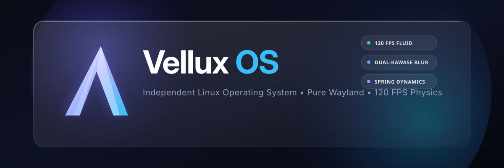

# Vellux OS 🌌

<div align="center">



**An independent, ultra-fluid Linux operating system designed for unprecedented visual aesthetics, physics-driven interactions, and uncompromising performance.**

[](LICENSE)
[](#architecture)
[](#compositor)
[](#ui-ux-design-language)

[Architecture](#architecture) • [Design System](#ui-ux-design-language) • [Roadmap](#development-categories-roadmap) • [Package Manager](#package-management) • [Build](#build-pipeline)

</div>

---

## 💎 Philosophy & Vision

Vellux OS is born out of a refusal to accept that Linux desktops must compromise on visual refinement. While traditional desktop environments bolt themes onto legacy display servers, **Vellux OS treats the visual layer as a first-class engineering discipline**:

1. **Pure Wayland Pipeline (Zero X11 Core):** Tear-free, sub-millisecond frame delivery locked to high-refresh hardware displays (60/120/144/240Hz).
2. **Real-Time Dual-Kawase Glassmorphism:** GPU-driven background blur, saturation boost, and dynamic specular edge highlights across all native surfaces.
3. **Mass-Spring-Damping Physics:** Elimination of artificial linear animation curves in favor of natural spring dynamics with realistic mass and inertia.
4. **Independent Foundation:** Not a skin over Debian or Arch. Independent toolchain, modern container-isolated package build system (`vellux-pkg`), and declarative recipes.

---

## 🏛 Architecture Overview

```
┌────────────────────────────────────────────────────────────────────────┐
│                        VELLUX HUMAN INTERFACE                          │
│  ┌───────────────────────┬──────────────────────┬───────────────────┐  │
│  │   Vellux Top Bar      │   Vellux Fluid Dock  │  Control Center   │  │
│  │ (Status, Menus, Time) │ (Magnification, Pop) │ (Modular Tiles)   │  │
│  └───────────────────────┴──────────────────────┴───────────────────┘  │
├────────────────────────────────────────────────────────────────────────┤
│                       VELLUX COMPOSITOR (Wayland)                      │
│  • Dual-Kawase Real-Time GPU Shader (Buzlu Cam / Glassmorphism)         │
│  • Spring Physics & Bezier Curves (1:1 Touchpad / Cursor Tracking)     │
│  • 16-24px Hardware Rounded Corners & Dynamic Drop Shadows             │
├────────────────────────────────────────────────────────────────────────┤
│                    CORE SYSTEM & SERVICES LAYER                        │
│  • PipeWire & WirePlumber (Ultra-low latency audio & feedback)        │
│  • NetworkManager & BlueZ (Instant reactive hardware toggles)          │
│  • systemd (Deterministic parallelized boot orchestration)             │
├────────────────────────────────────────────────────────────────────────┤
│                     LINUX KERNEL & DRIVER LAYER                        │
│  • Linux Kernel (Low-latency scheduler, modern DRM/KMS drivers)        │
│  • Plymouth Flicker-Free Boot (UEFI -> Smooth Crossfade -> Desktop)    │
└────────────────────────────────────────────────────────────────────────┘
```

---

## ✨ UI/UX Design Language: The Glass & Motion Spec

| Visual Property | Specification | Engineering Implementation |
| :--- | :--- | :--- |
| **Surface Blur** | Dual-Kawase GPU Shader (Radius: 20px, Iterations: 4) | Direct GLSL / Vulkan fragment pass |
| **Glass Border** | `1.0px solid rgba(255, 255, 255, 0.16)` | Hardware border shader with top-lit gradient |
| **Corner Radius** | `18px` (Dock), `14px` (Windows), `10px` (Widgets) | Antialiased rounded scissors |
| **Spring Model** | `stiffness: 320, damping: 24, mass: 1.0` | Discrete Euler / RK4 spring solver |
| **Frame Target** | 120 FPS constant with V-Sync lock | DRM/KMS atomic page flips |

---

## 🗺 Development Categories & Roadmap

The project is structured into **8 core engineering categories**:

- [x] **Category 1: Brand Identity & Architectural Blueprint**
  - Name, brand assets, architecture documentation, design tokens.
- [ ] **Category 2: Design System & Tokens (Vellux Glass Engine)**
  - Palette, typography (Geist / Inter Display), dynamic glass tokens, spring physics curves.
- [ ] **Category 3: Desktop Shell (Top Bar, Floating Dock, Control Center)**
  - Top bar with global menus, fish-eye magnifying floating dock, macOS-style control center.
- [ ] **Category 4: Wayland Compositor & Shader Pipeline**
  - High-performance compositor configurations, dual-kawase blur shaders, window animations.
- [ ] **Category 5: Package Engine (`vellux-pkg`)**
  - Recipe format (`Vpkgfile`), package build engine, sandbox isolation, repository database.
- [ ] **Category 6: Base System & Toolchain Bootstrap**
  - Core package recipes (Linux Kernel, Glibc, Coreutils, Bash, Wayland, PipeWire).
- [ ] **Category 7: Flicker-Free Boot Experience**
  - Plymouth boot theme with seamless transition from UEFI to desktop.
- [ ] **Category 8: Live Installation Media (Vellux ISO)**
  - Live boot environment with Calamares-based glass installer.

---

## 📦 Package Management: `vellux-pkg`

Packages are built declaratively via `Vpkgfile` definitions and packed into high-compression `.vpkg.tar.zst` archives:

```bash
# Example command flow
vellux-pkg build recipes/core/zlib
vellux-pkg install zlib-1.3.1-1-x86_64.vpkg.tar.zst
```

---

## 📄 License

Vellux OS is licensed under the [MIT License](LICENSE).
